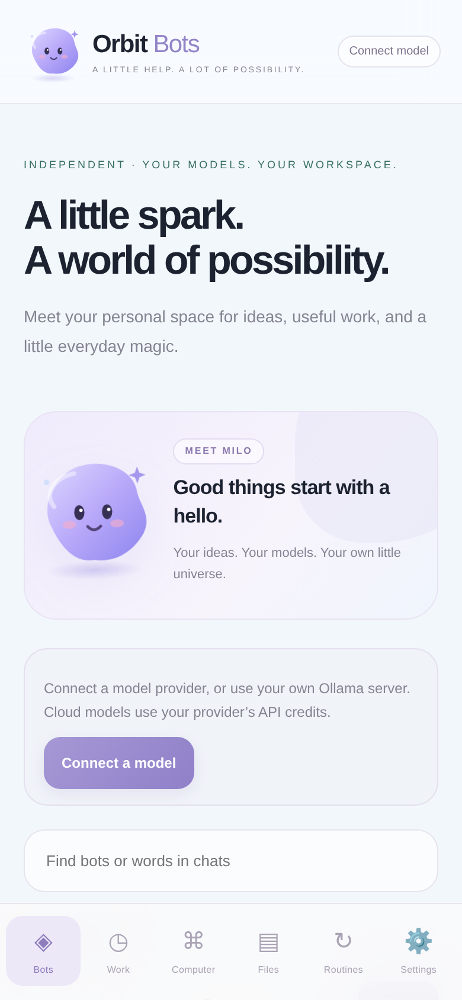

# Orbit Bot

An independent Android task assistant with configurable models, an encrypted private workspace and read-only web tools. Android 8.0+; no hosted account or subscription bundled.



## Version 2.0

- **Model connections:** native xAI Responses or an OpenAI-compatible Chat Completions endpoint. Presets for OpenAI, OpenRouter, Google Gemini compatibility, Groq and Ollama. Custom HTTPS base URLs supported. This is protocol compatibility, not a promise that every vendor/model implements the same features.
- **Ollama:** connect to an existing server on the phone or private LAN. No API key required by default. This APK does not install Ollama, download model weights or execute a model itself.
- **Private knowledge:** import text, Markdown, code, CSV or JSON into a bot's encrypted workspace. Models with function calling can search saved files using exact-text retrieval. No vector database or embedding claim.
- **Public web tools:** jsoup-based HTTPS page extraction and read-only crawling of up to three same-host HTML pages. Page text and links are returned to the selected model. Enable these tools explicitly in Settings. No browser automation, JavaScript execution, website login or paid crawler dependency.
- **Agent loop:** bounded model requests, text-file creation/reading, saved preferences, editable email drafts, cancellation, activity history and token counts reported by the provider. Models without function calling have a chat-only option.
- **Phone interface:** redesigned teal/blue cards, dark/light themes, searchable bots/chats, quick prompts, six role templates, file previews/exports and Android text sharing.
- **Voice:** Android dictation and read-aloud with 0.5–2× speed, plus a stop control. These use device speech services, not real-time xAI voice calls.
- **Routines:** daily runs only while the app is open and visible; missed runs are skipped.

## Install

Download the signed [Orbit-Bots-2.0.apk](https://github.com/sameerahmad86232/Orbitbots/raw/refs/heads/main/downloads/Orbit-Bots-2.0.apk), also available from the v2.0.0 release once the build passes. If Android asks, allow installation from the browser/file manager used to open it. Android 8.0 or newer is required. The release shares the signing identity of the earlier Orbit APK so it can update that installation.

1. Open Settings and choose a provider preset or custom OpenAI-compatible URL.
2. Save the connection **before** entering its API key. Credentials are bound to that exact URL and protocol; switching endpoints does not transfer the old key.
3. Save the key, then load models or enter a model ID available from that provider. A consumer chat subscription generally does not supply API credit.
4. Save task settings. Set request/token limits, enable local webpage tools if desired, and enable only features supported by your model.
5. Open a bot and run a task. Import reusable text knowledge from Files. Files stay local until a task actually reads them for the provider.

### Ollama

Ollama must already be running, with a model installed. Use its OpenAI-compatible API base, e.g. `http://192.168.1.20:11434/v1`, then save the connection, load models and select an installed model. `127.0.0.1` means the **Android phone**, not a separate computer. Server listening/firewall settings must allow the phone to reach it. Use trusted private networking; HTTP requests are unencrypted. Do not expose an unauthenticated Ollama server to the internet. For remote service, use authenticated HTTPS.

Use a model with tool support for agent actions; disable function calling for a chat-only model. Runtime availability, model capability and hardware requirements belong to the server setup. This project does not claim to run Ollama locally out of the box on an ordinary Android phone.

### Protocol limits

- xAI mode retains its Responses API integration, including optional provider-hosted web search, X search and code tools.
- Other presets use `/chat/completions` and `/models`. There is no automatic protocol guessing, provider fallback or silent model switching.
- OpenAI preset sends `max_completion_tokens`; other compatibility presets send `max_tokens`. A provider may reject unsupported models/parameters/tools. Model listing itself may be unavailable on some compatible services; enter the ID manually in that case.
- Anthropic's native Messages API and other proprietary APIs are not implemented. Anthropic models can be accessed through a compatible gateway such as OpenRouter if available to your account.
- Images require a vision-capable model; PDF attachments currently require xAI mode. Text/CSV/JSON/code work across providers. Maximum input attachment is 1.5 MB; text is limited to 300 KB. Old attachment bytes are not resent automatically; reattach when needed.
- Streaming responses, native audio analysis, XLSX parsing, image/video generation and realtime voice are not included.

## What is not included

This is not a 100% Grok Bot clone and not affiliated with xAI. There is no always-on cloud computer, browser-use/Skyvern runtime, terminal, arbitrary code execution on the phone, connected inbox, bot-owned email address, automatic email sending, payment processing, third-party OAuth connectors, team/shared approvals, cross-device sync, vector RAG or 24/7 scheduler. Open-source projects do not remove their hosting, hardware and account requirements. OpenClaw, CrewAI, LangGraph, Inbox Zero, Qdrant and the other suggested servers are not installed or integrated in this APK.

Email tools create a local draft. Users review/edit it and open their mail app to send themselves. Payment, purchase, posting and account-deletion tools do not exist in this build. There are no guaranteed earnings.

## Privacy and storage

Android Keystore AES-GCM protects local keys, app state, preferences, tasks and text artifacts. Keys are absent from UI state and chat/source exports. Prompts, attachments and retrieved files/pages are sent to the provider selected by the user. xAI mode requests `store:false`; provider retention policies still apply. Public web fetches never receive model API credentials. Provider requests refuse redirects. The WebView cannot make network requests itself and cannot load arbitrary remote content; native code makes the API calls.

Provider endpoints must use HTTPS except Ollama on a device/private network. Android cleartext networking is enabled to permit that explicit Ollama case; the native provider validator rejects public HTTP endpoints. Website crawling accepts public HTTPS on port 443, checks resolved addresses, rejects private/loopback targets and revalidates redirects. It is a lightweight reader, not an isolated browser security boundary against every DNS-rebinding scenario. Responses, redirects, files and loop counts are bounded. Exports leave encrypted app storage. Removing a provider key removes the selected endpoint's credential; erasing app data removes all local credentials/state. Uninstalling loses local data.

## Build

Requirements: Java 21 (including compiler), Node for JavaScript syntax checking, Python 3, zip utilities and Android SDK build-tools 35.0.0/platform android-35. jsoup 1.18.3 is vendored under its MIT license in `libs/`.

```sh
export ANDROID_SDK_ROOT=/path/to/android-sdk
bash build.sh
```

Without signing variables this creates `build/aligned.apk`, an unsigned artifact that must be signed before installation. For a signed APK set `ORBIT_SIGNING_STORE` and `ORBIT_SIGNING_PASSWORD` in your environment; alias must be `orbit`. Signing credentials are not shipped in source or GitHub. Output is `build/Orbit-Bots.apk`.

## Verification

```sh
bash tests/run.sh
# Separately serve assets on localhost:8014, then:
python3 -m http.server 8014 --directory assets
# In a second terminal with Playwright installed:
python3 test_ui.py
```

Provider contract tests use a real local HTTP server and test request/response translation, parallel tool calls, model discovery, chat-only mode, token fields, authentication, endpoint-bound credential IDs and insecure/private URL restrictions. They do not call a paid provider or load a language model. UI tests use a mocked native bridge and cover provider switching, Ollama configuration, knowledge import, file previews, templates, encrypted-state boundary behavior, tasks, drafts, exports, search, speed settings, mobile layout and untrusted-text rendering.

The Android sources compile and the release signature verifies. Physical Android installation, real Ollama inference and live paid-provider integration have **not** been verified in this environment.

## References

- [Ollama OpenAI compatibility](https://docs.ollama.com/openai)
- [Gemini OpenAI compatibility](https://ai.google.dev/gemini-api/docs/openai)
- [OpenAI Chat Completions](https://platform.openai.com/docs/api-reference/chat)
- [xAI developer docs](https://docs.x.ai/)
- [jsoup](https://jsoup.org/)
